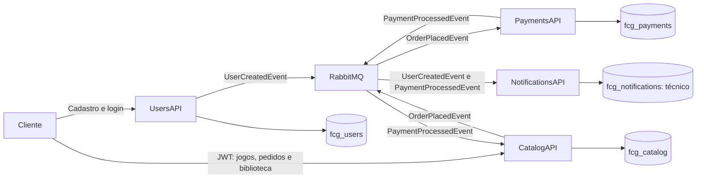

# Visão técnica da solução

Quatro serviços .NET 8 independentes, com projetos, Dockerfiles, migrations, testes e manifestos Kubernetes próprios. A infraestrutura centraliza contratos V1 e orquestração; não fornece biblioteca compartilhada de domínio nem acesso compartilhado a tabelas.

Os bancos lógicos e suas credenciais são separados. A instância PostgreSQL compartilhada é conveniência da instalação local; não há consultas ou FKs entre bancos. RabbitMQ usa MassTransit, filas distintas por consumidor e contratos locais compatíveis com a [especificação V1](../contracts/v1/README.md).

## Responsabilidades e interfaces

| Serviço | Responsabilidade | HTTP | Eventos |
|---|---|---|---|
| Users | Cadastro, JWT, papéis e bootstrap | /api/users, /api/auth/login, /api/admin/users | Publica UserCreatedEvent |
| Catalog | Jogos, pedido, biblioteca e concessão | /api/games, /api/orders, /api/library | Publica OrderPlacedEvent; consome PaymentProcessedEvent |
| Payments | Resultado simulado determinístico | Somente health checks | Consome OrderPlacedEvent; publica PaymentProcessedEvent |
| Notifications | Boas-vindas e confirmação no console | Somente health checks | Consome UserCreatedEvent e PaymentProcessedEvent |

Todos expõem /health/live e /health/ready. Catalog valida o JWT emitido por Users sem consulta HTTP a Users; identidade vem de sub. Escritas no catálogo exigem Admin; pedido e biblioteca são restritos ao proprietário.

## Compra e confiabilidade

POST /api/orders recebe somente gameId. Catalog captura preço atual e identidade autenticada, grava Pending + Outbox e responde 202 com orderId/status. Payments persiste um resultado por OrderId: Approved ou Rejected, conforme configuração de operação. O cliente não escolhe o resultado. Somente Approved concede o jogo e gera confirmação; Rejected permite novo pedido. Unicidade no PostgreSQL e transações protegem concorrência, posse e pedidos pendentes.

Users, Catalog e Payments usam Outbox transacional. Consumidores mantêm Inbox/idempotência e restrições de unicidade; retentativas finitas precedem filas de erro. Catalog/Notifications recebem cópias independentes do resultado. Entrega é at-least-once; não há Saga ou Event Sourcing. Notifications mantém uma identidade lógica única, mas falha entre stdout e commit pode repetir fisicamente o log.

## Implantação e verificação

Compose: dependências + quatro APIs, migrations/bootstrap explícitos antes das APIs. Kubernetes: contexto docker-desktop, namespace fcg-phase2, Deployments, Services ClusterIP, ConfigMaps, Secrets externos, Jobs explícitos e PVCs. Uma réplica local não representa alta disponibilidade. Logs estruturados não contêm senha, hash ou JWT nos eventos.

Reprodução: [Compose](../implementation/compose-complete.md), [Kubernetes](../implementation/kubernetes-desktop.md), [recuperação](../implementation/recovery-runbook.md). Resultados e limites: [índice de evidências](../quality/evidence-index.md). As decisões completas permanecem nos [ADRs aceitos](decisions/README.md).
